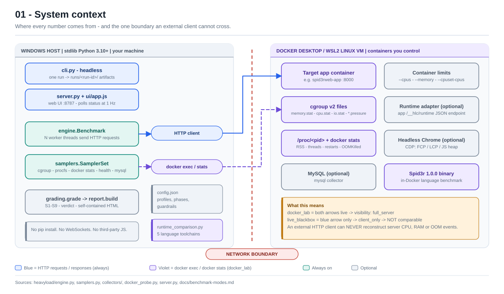
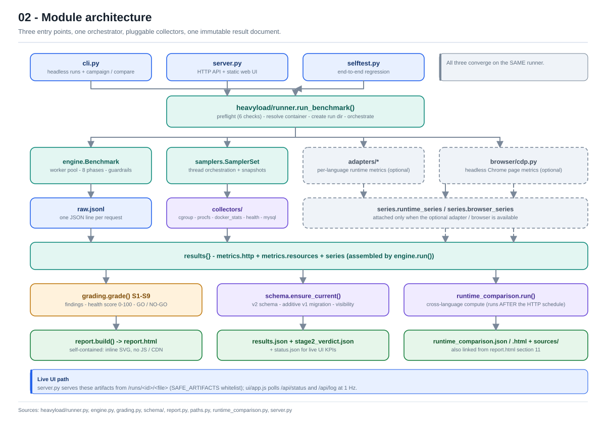
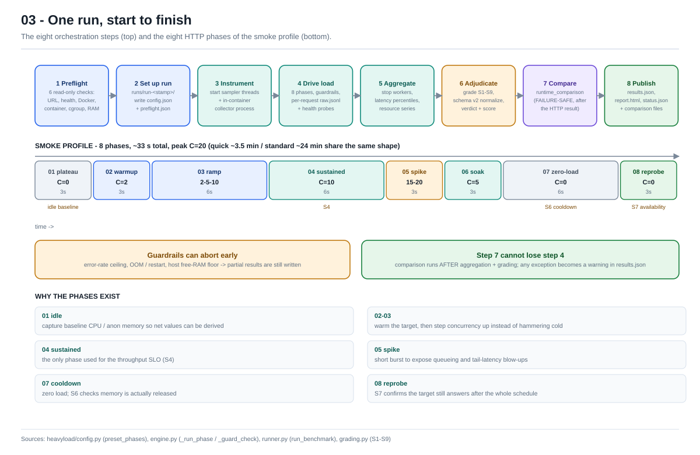
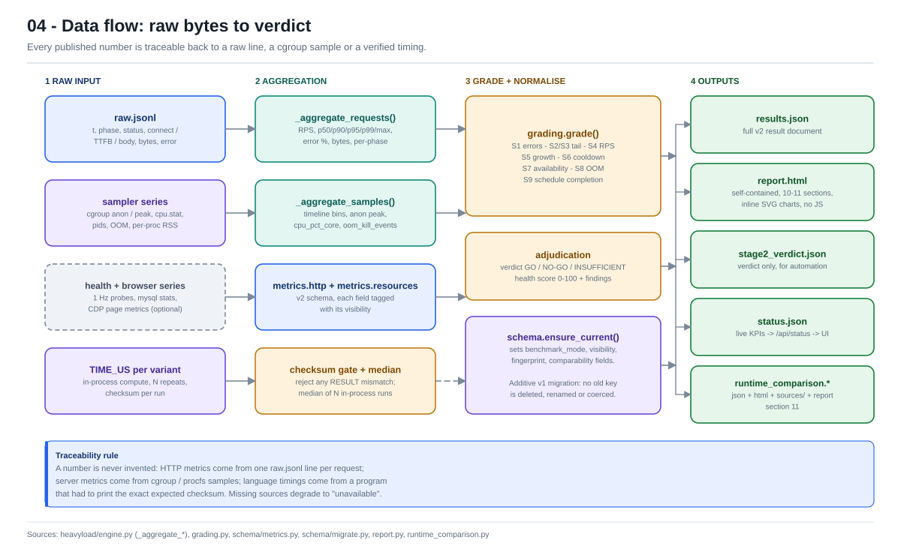
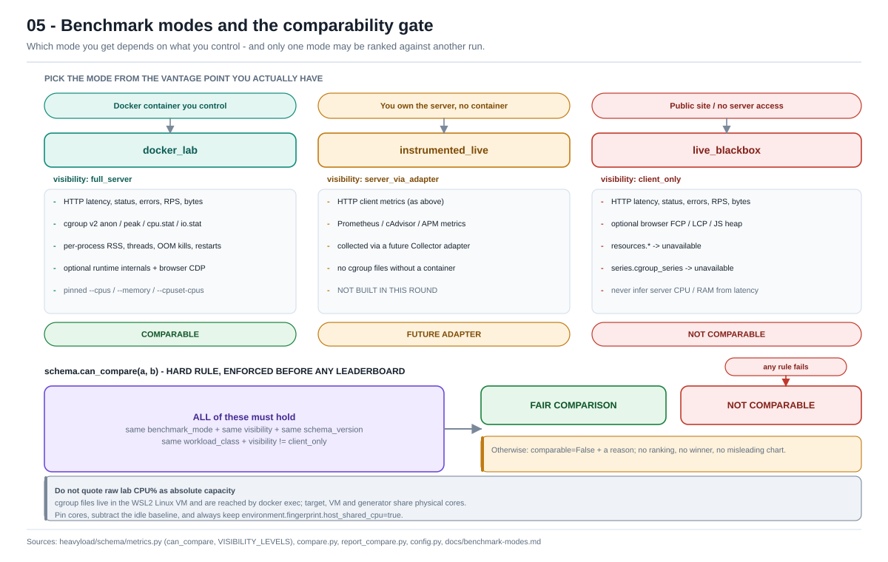
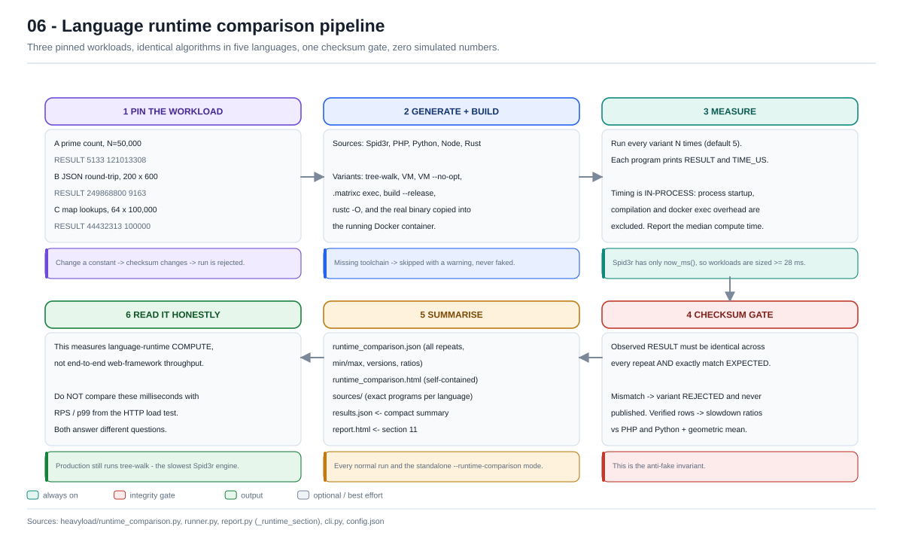

# Heavy Load Checker

A standard-library-only Python HTTP load tester with a local web UI. It drives
a phased workload at a target and, when the **Docker** runtime environment is
selected, measures real server-side CPU, memory, cgroup pressure, OOM events
and per-process usage.

> **Key fact:** for a live website you do not control, an external client can
> never see server CPU/RAM. Those runs are labelled `client_only` and are not
> comparable with Docker lab runs. **Windows runtime mode is the default and is
> exactly such a client-only run.** See
> [docs/benchmark-modes.md](docs/benchmark-modes.md).

## Quickstart

```bat
start.bat
```
opens <http://127.0.0.1:8787/> (Windows). Or:

```bash
python server.py --open              # web UI
python cli.py --profile smoke        # headless, ~33 s, Windows runtime (default)
python cli.py --runtime-env docker --profile smoke   # add container cgroup metrics
python cli.py --runtime-comparison   # language-runtime speed only, no HTTP load
python cli.py --campaign benchmarks/lang-runtime.json   # Phase 2 batch campaign
python cli.py --compare run-a run-b --output out/       # compare + export runs
python selftest.py                   # end-to-end regression test
python -m unittest discover -s tests -v
```

Requirements: Python 3.10+ (tested on 3.13). No pip install is required.
**Docker Desktop is only needed when you choose the Docker runtime
environment** — the default Windows mode needs no Docker at all.

## Runtime environment: Windows (default) or Docker

A single **exclusive** switch, `config.runtime_environment`, decides both
(a) which installed runtimes the language load check measures and (b) which
vantage point the HTTP load test measures from. There is no second,
contradictory instrumentation selector.

| | `windows` **(default)** | `docker` |
|---|---|---|
| Installed host runtimes (PHP / Python / Node / Rust / Spid3r) | **checked** | checked (kept as baselines) |
| Spid3r binary inside the container | not measured | **added** to the host baselines |
| HTTP metrics | latency, throughput, error taxonomy, availability | same, **plus** cgroup CPU / RAM, PSI, OOM, restarts |
| `visibility` | `client_only` | `full_server` (when a container resolves) |
| `mode` / `benchmark_mode` | `direct` / `live_blackbox` | `auto` / `auto` → `docker_lab` |
| Docker daemon needed | **no** | yes |
| S5 / S6 memory-recovery SLOs | `N/A` — insufficient evidence | graded from cgroup bytes |
| `include_windows` / `include_container` | `true` / `false` | `true` / `true` |

**Docker is additive, not a replacement.** Host PHP and Python rows are the
measuring stick for every slowdown ratio, so they stay in both modes. Docker
rows are tagged `source: "docker"` in the JSON and labelled "Docker container"
in the HTML, with an explicit note that they run in a *different environment*
from the host baselines — their ratios are approximate, never an
apples-to-apples deployment benchmark.

Change it in one place:

```bash
python cli.py --runtime-env docker --profile smoke   # CLI, one run
python cli.py --runtime-env windows --profile smoke  # back to the default
```

or use the **Runtime environment** radio card at the top of the web UI (Windows
is pre-selected; the Docker option is disabled when no daemon is reachable).
Or edit `config.json`:

```json
"runtime_environment": "windows",
"mode": "direct",
"benchmark_mode": "live_blackbox",
"runtime_comparison": { "include_windows": true, "include_container": false }
```

A saved config predating the switch is **inferred once** from legacy Docker
signals (`include_container`, `benchmark_mode: docker_lab` /
`instrumented_live`, or `mode: docker`) so existing Docker setups keep working;
a fresh config always defaults to Windows. Because a saved config carries the
derived keys explicitly, always change the switch through `--runtime-env` or
the web UI: those rewrite all four derived keys together. Setting
`runtime_environment` alone leaves a half-configured state.

**Windows overrides are rejected, not silently ignored:** `--mode auto|docker`
or `--benchmark-mode docker_lab|instrumented_live` combined with the Windows
runtime environment exits with `use --runtime-env docker`. Internally, the
runner also forces `container=""`, `mode="live_blackbox"`, a hard sampler gate
and `visibility="client_only"`, so a Windows run can never publish cgroup
numbers or be ranked against a Docker lab run.

## Architecture at a glance

Six diagrams in [docs/diagrams/](docs/diagrams/) explain the system end to end.
They are plain inline-styled SVG — no JavaScript, no CDN, no build step — so
they render in this README, in an IDE, and offline. Start with 01 and 02; the
rest are reference material. Prefer one page? Open the
[single-file gallery](docs/diagrams/index.html) (all six inlined, works offline).
**Contributing?** That gallery is also the developer reference: developer notes
under each diagram, plus commands, module map, config keys, the v2 result
schema, S1–S9 SLOs, artifacts, the web API, the language-benchmark contract,
extension seams, invariants and a glossary.

| # | Diagram | Question it answers |
|---|---|---|
| 01 | [System context](docs/diagrams/01-system-context.svg) | What can this tool actually measure? |
| 02 | [Module architecture](docs/diagrams/02-architecture.svg) | Which module does what? |
| 03 | [Run lifecycle](docs/diagrams/03-run-lifecycle.svg) | What happens during one run? |
| 04 | [Data flow](docs/diagrams/04-data-flow.svg) | Where does every published number come from? |
| 05 | [Modes & comparability](docs/diagrams/05-benchmark-modes.svg) | When may two runs be ranked against each other? |
| 06 | [Runtime comparison](docs/diagrams/06-runtime-comparison.svg) | How is the language benchmark kept honest? |

### 01 — System context



**Read it as:** the load generator lives on your Windows host and only ever
speaks HTTP to the target. Server CPU, RAM, cgroup pressure and OOM events are
read *inside* the container via `docker exec` / `docker stats`. If that second
path is unavailable (a public website), the run is `client_only` — you get real
latency, but no server metrics. This boundary is the single most important
thing to understand before quoting any number.

### 02 — Module architecture



**Read it as:** `cli.py`, `server.py` and `selftest.py` all call the same
`runner.run_benchmark()`. It fans out to the load engine, the sampler/collector
stack and optional adapters, then merges everything into one `results{}` dict.
Grading, schema normalisation, the language comparison and the HTML report all
consume that dict. Dashed boxes are optional — a missing Docker daemon, runtime
endpoint or headless Chrome degrades to `unavailable`, it never fails a run.

### 03 — Run lifecycle



**Read it as:** every profile uses the same eight phases — idle baseline,
warm-up, ramp, sustained, spike, soak, zero-load cooldown, availability
re-probe — only the durations change. The idle and cooldown phases exist so
memory growth (S5/S6) means something. Note step 7: the language comparison
runs **after** the HTTP result is aggregated, so a comparison failure can never
cost you a load-test run.

### 04 — Data flow



**Read it as:** one `raw.jsonl` line per request, one cgroup/procfs sample per
tick, and one `TIME_US` per language variant. Each is aggregated, graded
against SLOs S1–S9, normalised to the v2 schema, then published. Nothing is
estimated: if a source is missing, the field is labelled `unavailable`. The
v1 → v2 migration is additive, so archived reports still render.

### 05 — Modes and the comparability gate



**Read it as:** the mode is decided by what you control, not by what you wish
you could measure. Before any leaderboard, `schema.can_compare()` demands the
same `benchmark_mode`, `visibility`, `schema_version` and `workload_class`, and
rejects `client_only` outright. A failure produces `comparable=False` with a
reason — never a ranking. On Windows, also remember the generator and the WSL2
VM share physical cores.

### 06 — Language runtime comparison



**Read it as:** three pinned workloads are written in five languages, built
into 10–11 variants (in Windows runtime mode these are the **installed host
runtimes**; choosing Docker **adds** the real binary inside the container), and
timed in-process over N repeats. Any variant whose checksum differs is
**rejected**, so no simulated or estimated value can reach a report. These
milliseconds measure language-runtime compute — do not compare them with the
RPS or p99 from the HTTP load test.

To change a diagram, edit [docs/diagrams/generate.py](docs/diagrams/generate.py)
and run `python docs/diagrams/generate.py`; the SVGs are generated files.
See [docs/diagrams/README.md](docs/diagrams/README.md) for the full index.

## Language runtime comparison (runs on EVERY benchmark by default)

This is the "test my language" feature. Alongside the HTTP load test, every run
executes **three identical, checksum-verified workloads** in every available
runtime and compares Spid3r against PHP, Python, Node and Rust. With the
default **Windows** runtime environment this load-checks the *installed* host
toolchains only; selecting **Docker** adds the deployed container variants
while keeping the host baselines (see the table above):

| ID | Workload | What it exercises |
|---|---|---|
| A | Prime counting, N = 50,000 | pure interpreter integer loops |
| B | JSON round-trip, 200 rows x 600 rounds | native serializers + parsed-field loops |
| C | String-keyed map lookups, 64 keys x 100,000 | route / config / session style lookups |

Spid3r variants measured: tree-walk, bytecode VM, VM `--no-opt`, bytecode
`exec`, `build --release`, **and, only when Docker is selected, the real
Spid3r binary inside the Docker container** (so you compare the version you
actually deploy, not just the host one). Output per run directory:

```
runtime_comparison.json    full raw data: every repeat, min/max, versions, ratios
runtime_comparison.html    self-contained report (charts, tables, method, warnings)
sources/                   the exact generated programs in every language
```

The main `report.html` gains **section 11** with the slowdown summary, and the
web UI shows direct links to the two new artifacts.

```bash
# Fast path: ONLY the language comparison (store may be down, no HTTP traffic)
python cli.py --runtime-comparison
#   -> runs/runtime-comparison/   (always the latest result, overwritten)
#   -> runs/runtime-<timestamp>/ (immutable archive of that run)

# Normal run: HTTP load test + comparison (default)
python cli.py --profile smoke

# Skip it for one run, or shorten it while iterating
python cli.py --profile smoke --no-runtime-comparison
python cli.py --runtime-comparison --runtime-repeats 1
```

Configure in `config.json`:

```json
"runtime_comparison": {
  "enabled": true,
  "repeats": 5,
  "container": "",
  "include_windows": true,
  "include_container": false,
  "include_native": true,
  "include_references": true,
  "write_sources": true,
  "timeout_s": 300,
  "workloads": ["prime", "json", "map"]
}
```

`include_windows: true` is what makes the *default* run load-check the
installed host toolchains. `include_container: false` is the default; choosing
the Docker runtime environment sets it to `true` **without** turning
`include_windows` off, because `summarize_data()` computes every slowdown ratio
against the host PHP / Python baselines. `container` empty means use
`config.container`, or auto-resolve it from the published Docker port — only
relevant in Docker mode. Missing toolchains are skipped with a warning — they
are never simulated. Archived v1 comparison documents have no recorded
provenance; their rows are labelled from evidence (Docker keys / "(Docker)"
labels) and otherwise `unavailable`, never invented as Windows.

**Honesty rules baked into the code:** workload constants are pinned; every
variant must print the exact expected checksum or it is **rejected and never
published**; timing is in-process (startup excluded); the median of N repeats
is reported; Spid3r only exposes `now_ms()`, so all workloads are sized well
above 1 ms resolution. This measures **language-runtime compute speed**, not
end-to-end web-framework performance — do not compare these numbers with RPS
from the HTTP load test.

Expected verified checksums (change a constant and the run is rejected):

```
A  RESULT 5133 121013308
B  RESULT 249868800 9163
C  RESULT 44432313 100000
```

## Benchmark modes (derived from the runtime switch)

| `benchmark_mode` | Server CPU/RAM | Comparable across languages | Selected by |
|---|---|---|---|
| `live_blackbox` **(default)** | No — `visibility: client_only` | **No** | `runtime_environment: windows` |
| `docker_lab` | Yes | **Yes** | `runtime_environment: docker` + a resolving container |
| `instrumented_live` | Via your own Prometheus/APM agent (future adapter) | Possible | advanced override |

The `Runtime environment` switch is the primary control; `mode` and
`benchmark_mode` are **derived** from it and are shown read-only in the web UI.
`auto` means `docker_lab` when a container resolves, otherwise client-only
`live_blackbox`. Advanced users can still set `config.benchmark_mode` directly,
but a Windows run is always forced back to client-only internally (no cgroup
collectors, `visibility = client_only`, S5/S6 graded `N/A`). A
`live_blackbox` result can never be ranked against a `docker_lab` result.

## Folder layout

```
cli.py  server.py  selftest.py  start.bat  config.json   entry points / live config
heavyload/            core package
  engine.py  runner.py  config.py  grading.py  report.py  util.py
  runtime_comparison.py   cross-language runtime benchmark + standalone report
  paths.py  http_client.py  latency.py  targetspec.py   shared helpers
  collectors/   cgroup / procfs / docker stats / health / mysql
  schema/       v2 metric schema + additive v1 migration
  adapters/     per-language runtime metrics (Python reference + 5 endpoint adapters)
  browser/      optional Chrome DevTools Protocol page metrics
ui/             vanilla-JS single-page UI (1 Hz polling)
targets/        per-site specs + examples (future campaigns)
benchmarks/     campaign files (Phase 2 — `lang-runtime.json` example)
docs/           architecture, schema, modes, roadmap, screenshot
  diagrams/     six core SVG diagrams + generate.py (shown in this README)
scripts/        reversible cleanup + Docker lab helpers
tests/          stdlib unittest suite
runs/           generated results (gitignored)
_archive/       verified backup of legacy sources and past runs (gitignored)
```

## Measuring a website written in language X

1. Write a spec in `targets/<site-id>.json` (start from
   `targets/examples/python-fastapi.json`). Keep the **same routes, payloads and
   resource limits** for every language.
2. `python scripts/lab_up.py <site-id>` (dry run) then `--build --apply`.
3. Set `config.fairness.cpuset_generator` to cores **different** from the
   spec's `resource_limits.cpuset_cpus`.
4. Run at least 3 repeats and compare medians.
5. `python scripts/lab_down.py <site-id> --apply` when done.

`targets/_schema.json` documents every field.

## Running a multi-language campaign (Phase 2)

A *campaign* runs the **same workload** against N sites (each a
`targets/*.json` spec) so you can compare runtimes fairly. Each site gets
warm-up passes (discarded) + `repeat_count` measured passes; the campaign
reports the **median across repeats** so one noisy run does not decide the
ranking.

```bash
# 1. Build & start every target container (see scripts/lab_up.py)
python scripts/lab_up.py python-fastapi-hello --build --apply
python scripts/lab_up.py node-express-hello    --build --apply

# 2. Run the campaign (writes benchmarks/<id>/campaign.json + report.html)
python cli.py --campaign benchmarks/lang-runtime.json

# 3. Compare any existing runs by id (writes out/campaign.json + .csv/.json)
python cli.py --compare run-a run-b --output out/
```

In the web UI: the **Campaigns** card starts/stops a campaign and shows live
per-site progress + history; the **Past runs** table has checkboxes and a
**Compare** / **Export CSV** bar that opens the comparison report.

> **Honesty guard:** runs are only ranked when every selected run is measured
> from the same vantage point — `docker_lab` mode with server CPU/RAM visible.
> `live_blackbox` (client-only) runs, or runs with a different mode / schema /
> workload class, are flagged **not comparable** and never produce a misleading
> leaderboard. See [docs/phase2-roadmap.md](docs/phase2-roadmap.md).

## Cleanup / safety

`scripts/archive_legacy.py` copies legacy sources and past runs into `_archive/`
and verifies every file by SHA-256 before anything is removed. Caches go to the
**Windows Recycle Bin**, never a permanent delete. Nothing is deleted without
`--confirm`.

```bash
python scripts/archive_legacy.py manifest
python scripts/archive_legacy.py backup
python scripts/archive_legacy.py verify
python scripts/archive_legacy.py recycle-caches --confirm
```

## Documentation

- [docs/diagrams/](docs/diagrams/) — the six core architecture diagrams shown above (+ how to regenerate them)
- [docs/benchmark-modes.md](docs/benchmark-modes.md) — why Docker is required, Windows/WSL2 caveats
- [docs/metric-schema.md](docs/metric-schema.md) — v2 result fields and units
- [docs/architecture.md](docs/architecture.md) — module map and data flow
- [docs/phase2-roadmap.md](docs/phase2-roadmap.md) — multi-language campaigns (Phase 2 status + deferred work)
