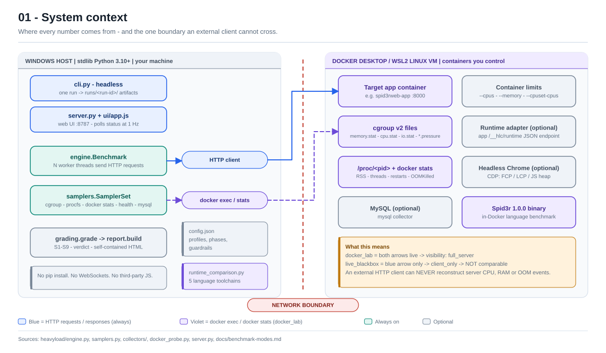
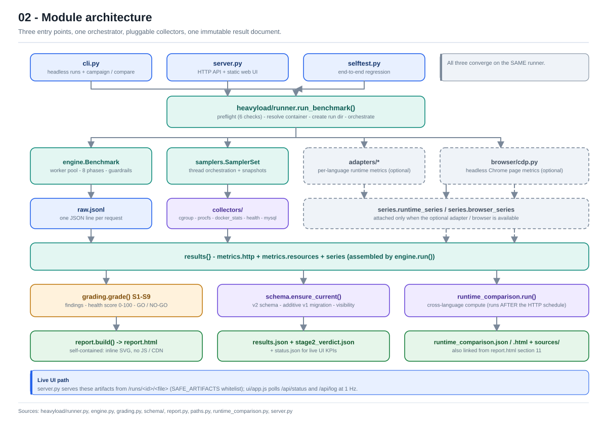
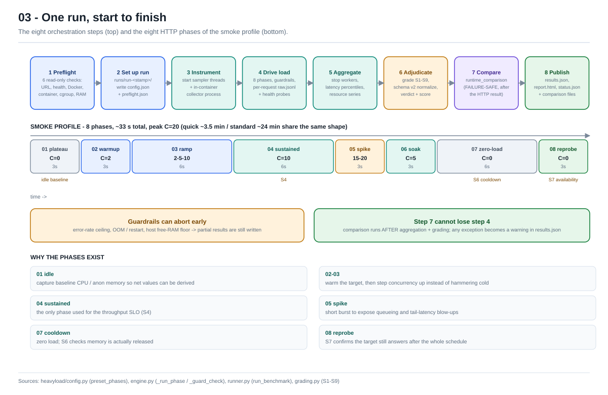
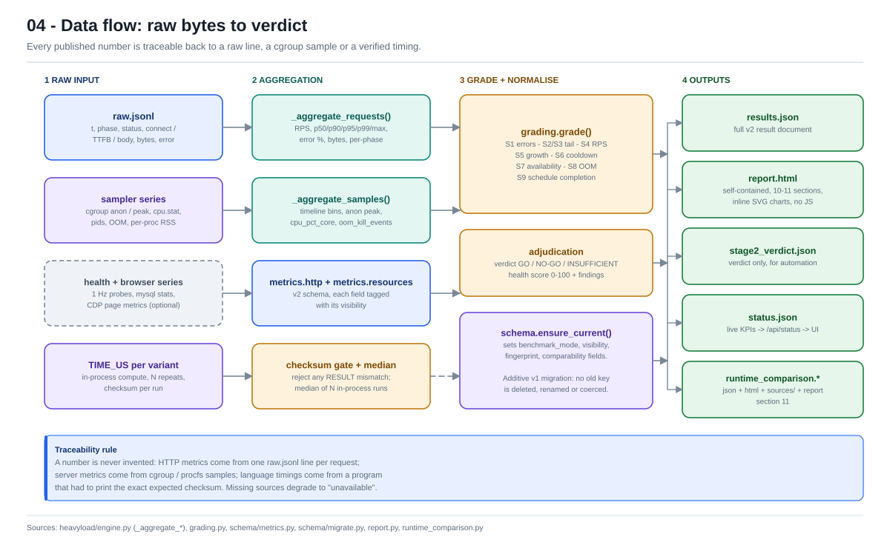
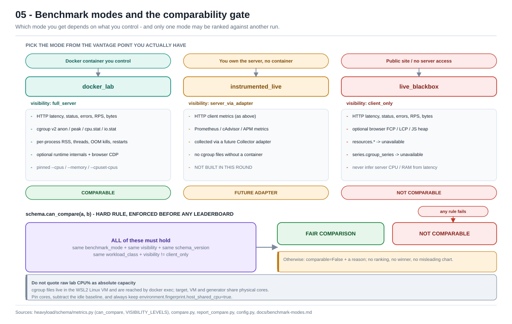
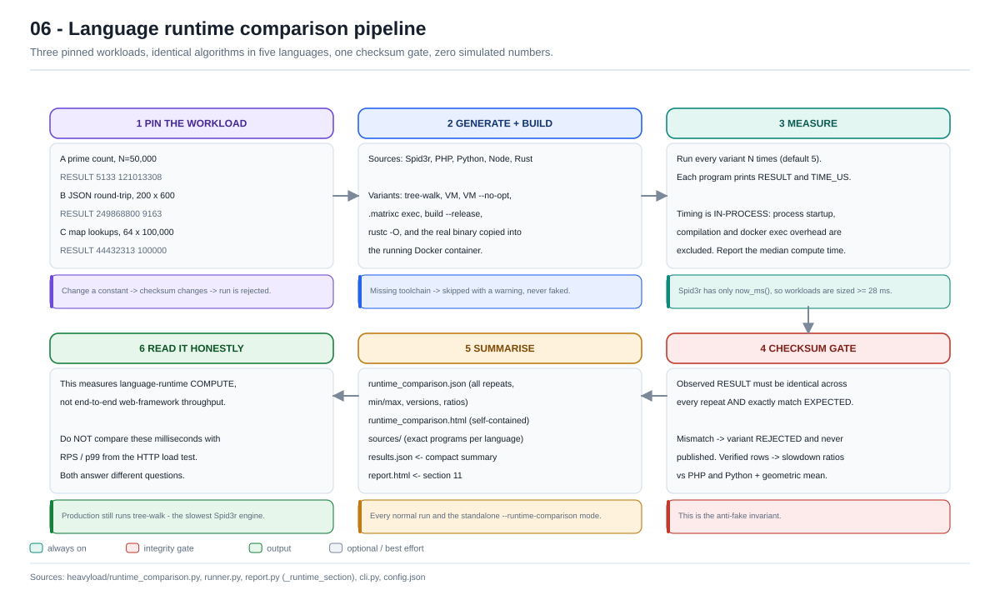

# Core diagrams

Six diagrams that explain **how Heavy Load Checker works**, from the
measurement boundary down to the artifact files. They are also embedded in the
[root README](../../README.md) under "Architecture at a glance".

All six are **standalone SVG**: inline attributes only, no `<style>`, no
JavaScript, no external fonts, no CDN, no `<image>`. That means they render on
GitHub, in an IDE preview, in a browser and in print — online or offline.

## Index

| File | What it explains | Read it when… |
|---|---|---|
| [01-system-context.svg](01-system-context.svg) | Windows host vs Docker/WSL2 target; the network boundary | you are about to quote a CPU or memory number |
| [02-architecture.svg](02-architecture.svg) | Entry points → runner → engine/collectors → grading → artifacts | you need to find the module that owns a behaviour |
| [03-run-lifecycle.svg](03-run-lifecycle.svg) | 8 orchestration steps + 8 HTTP phases of the smoke profile | you are changing a profile, a phase or a guardrail |
| [04-data-flow.svg](04-data-flow.svg) | raw.jsonl / cgroup samples / TIME_US → graded metrics → outputs | you are adding a metric or a field to `results.json` |
| [05-benchmark-modes.svg](05-benchmark-modes.svg) | `docker_lab` / `instrumented_live` / `live_blackbox` + `can_compare()` | you are comparing two runs or building a leaderboard |
| [06-runtime-comparison.svg](06-runtime-comparison.svg) | Pinned workloads → sources → variants → checksum gate → ratios | you are changing the language benchmark or its workloads |

**[index.html](index.html)** is a generated single-file gallery with all six
SVGs inlined — open it locally for one printable page with zero network
requests. It is also the **developer reference**: each diagram is followed by
concrete developer notes (which module owns the behaviour, the functions to
call, the failure modes), and the page ends with a lookup sheet covering
commands, the module map, config keys, the v2 result document, S1–S9 SLOs,
per-run artifacts, the web API, the language-benchmark contract, extension
seams, invariants/gotchas and a glossary. Start there when contributing.

Legend used throughout: **solid box** = always on, **dashed box** = optional /
best effort, **blue** = HTTP path, **violet** = Docker / instrumentation read
path, **green** = output artifact, **amber** = caveat or decision, **red** =
integrity gate or a hard "no".

---

## 01 — System context



The tool has two read paths, not one. The blue path (HTTP) always exists; the
violet path (`docker exec`, `docker stats`, cgroup v2 files) only exists when
you control the container. A client-only run can never see server CPU, RAM,
OOM kills or restarts — those live behind the network boundary.

## 02 — Module architecture



`cli.py`, `server.py` and `selftest.py` converge on one orchestrator,
`heavyload/runner.run_benchmark()`. Everything downstream consumes a single
`results{}` dict. Optional collectors degrade to `unavailable` instead of
failing the run.

## 03 — One run, start to finish



Preflight → run dir → instrumentation → 8 phases → aggregation → grading →
language comparison → publish. The phase bar shows the **smoke** profile
(~33 s); `quick` and `standard` use the same shape with longer durations.
The language comparison deliberately runs last, so its failure cannot lose the
HTTP result.

## 04 — Data flow: raw bytes to verdict



Every published number is traceable: HTTP metrics from one `raw.jsonl` line per
request, resource metrics from cgroup / procfs samples, language timings from a
program that had to print the exact expected checksum. The v2 schema migration
is additive, so old reports keep rendering.

## 05 — Modes and the comparability gate



`schema.can_compare()` is a hard rule: same `benchmark_mode`, `visibility`,
`schema_version` and `workload_class`, and never `client_only`. A failure sets
`comparable=False` with a reason and produces **no leaderboard**.

## 06 — Language runtime comparison



Three pinned workloads, identical algorithms in five languages, 10–11 real
variants (including the Spid3r binary inside the running container), in-process
timing, and a checksum gate that rejects any mismatch. Missing toolchains are
skipped with a warning — never simulated. This measures language-runtime
compute, **not** HTTP throughput.

---

## Regenerating / editing

The SVGs **and `index.html`** are generated files. Edit the declarations in
[`generate.py`](generate.py), then:

```bash
python docs/diagrams/generate.py
```

`generate.py` uses only the Python standard library — no pip install, no
Mermaid CLI, no network. Each `d0N()` function is one diagram; `Canvas` provides
`box()`, `lane()`, `note()`, `chip()`, `arrow()`, `diamond()` and `legend()`.
Colours are inline (`PAL` dict), light theme with dark ink, so GitHub's SVG
sanitiser cannot strip the styling.

The gallery prose lives in the data tables near the bottom of `generate.py`
(`INDEX` developer notes, `COMMANDS`, `MODULES`, `CONFIG_KEYS`, `RESULT_FIELDS`,
`SLOS`, `ARTIFACTS`, `API`, `WORKLOADS`, `SEAMS`, `INVARIANTS`, `GLOSSARY`) —
edit those, not `index.html`. `namespace_svg()` suffixes every id when the six
SVGs are inlined, so marker/`aria-labelledby` references stay valid in one
document. `fmt()` escapes text and turns `` `inline code` `` into `<code>`;
never inject raw HTML into those strings.

When the code changes, keep the diagrams in sync. Source of truth per diagram:

| Diagram | Code / docs to check |
|---|---|
| 01 | `heavyload/engine.py`, `samplers.py`, `collectors/`, `docker_probe.py`, `server.py`, `docs/benchmark-modes.md` |
| 02 | `heavyload/runner.py`, `config.py`, `grading.py`, `schema/`, `report.py`, `paths.py`, `runtime_comparison.py` |
| 03 | `heavyload/config.py` (`preset_phases`), `engine.py` (`_run_phase`, `_guard_check`), `runner.py`, `grading.py` |
| 04 | `heavyload/engine.py` (`_aggregate_*`), `grading.py`, `schema/metrics.py`, `schema/migrate.py`, `report.py` |
| 05 | `heavyload/schema/metrics.py` (`can_compare`, `VISIBILITY_LEVELS`), `compare.py`, `report_compare.py` |
| 06 | `heavyload/runtime_comparison.py`, `runner.py`, `report.py` (`_runtime_section`), `cli.py`, `config.json` |

A quick sanity check after regenerating:

```bash
python -c "import glob,xml.etree.ElementTree as E; [E.parse(p) for p in glob.glob('docs/diagrams/*.svg')]; print('SVG OK')"
```
